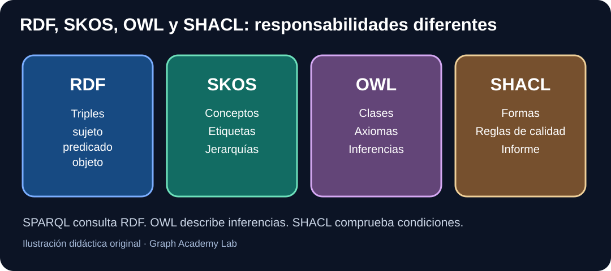

# Taller guiado 02 — GraphDB desde cero: repositorio RDF, SPARQL, inferencia y exportación



**Nivel:** sabes Python y has estudiado [qué es una ontología](semana-11.md), [SKOS/SPARQL](semana-12.md) y [OWL](semana-13.md). **Antes de empezar**, termina [el taller Protégé](especializacion-protege-owl.md). Duración orientativa: 5–7 horas con ejercicios.

**Meta:** instalar una edición adecuada de GraphDB, importar RDF, crear y consultar un repositorio, comprender datos explícitos frente a inferidos, exportar e interpretar qué cambió. Todos los datos serán públicos y ficticios.

## 1. ¿Por qué otro motor si ya sabemos Neo4j?

En Neo4j estudiamos **grafos de propiedades** y el lenguaje **Cypher**. RDF utiliza otro modelo: cada afirmación es un triple de **sujeto, predicado y objeto**. Un repositorio RDF permite guardar y consultar triples mediante **SPARQL**.

**GraphDB**, de Ontotext, es una plataforma para gestionar RDF que puede ofrecer inferencia configurable. **No es simplemente «Neo4j con otro nombre»**.

| Concepto | Qué significa | Ejemplo |
|---|---|---|
| Triple RDF | Una afirmación de tres partes | libro001 → titulo → «El mapa» |
| Repositorio | Conjunto de datos RDF gestionados bajo una configuración | biblioteca-lab |
| SPARQL | Lenguaje para consultar patrones RDF | Buscar triples cuyo predicado es titulo |
| Workbench | Interfaz web de administración y consulta | Importar un fichero Turtle |
| Regla de inferencia | Criterio para derivar consecuencias de los datos | LibroDigital subclase de Libro |
| Materialización | Conservar consecuencias derivadas como datos accesibles según el motor | Resultado de una regla de inferencia |
| SHACL | Condiciones de validación de grafos RDF | Libro necesita título |

### Qué diferencia hay entre repositorio y grafo con nombre

Un **repositorio** es una unidad de almacenamiento y configuración de GraphDB. Un **grafo con nombre** (*named graph*) es una parte del modelo **RDF Dataset**, identificada mediante una IRI. Un repositorio puede contener datos asociados a distintos grafos.

**Un grafo con nombre no significa «otra base de datos»**. No confundas segmentar datos RDF con crear repositorios o instancias independientes.

## 2. Preparar GraphDB sin publicar secretos

1. Consulta la [documentación oficial de GraphDB](https://graphdb.ontotext.com/documentation/) y elige una versión concreta.
2. Revisa las licencias y límites de la edición que vas a instalar.
3. Instala o inicia GraphDB siguiendo el manual de esa edición.
4. Abre **GraphDB Workbench**, normalmente mediante la dirección local indicada por la instalación. No presupongas un puerto universal si la configuración cambió.
5. Localiza la vista de **Repositories** y crea un repositorio con ID ficticio `biblioteca-lab`.
6. Selecciona una configuración de inferencia deliberada y **anota cuál elegiste**. Para empezar suele ser más fácil diferenciar resultados si sabes si la inferencia está desactivada o configurada.

La interfaz y las opciones concretas pueden variar entre versiones. Nuestro material describe objetivos verificables, y los menús deben contrastarse con la documentación oficial de la instalación utilizada.

**¿Qué debes haber conseguido?** Un repositorio conectado y seleccionado. Si ejecutas consultas en otro repositorio podrías recibir resultados vacíos sin que tu código esté mal.

## 3. Importar un RDF real del laboratorio

Vamos a cargar el archivo:

`ejemplos/ontologias/ontologia-biblioteca.ttl`

Ese archivo define:

- Clases Libro, LibroDigital y Autor.
- Propiedades escritoPor, escribio y titulo.
- Individuos libro001, libro002 y autor001.
- Relación de subclase LibroDigital → Libro.
- Un axioma que establece propiedades inversas.

### Importación paso a paso

1. En Workbench selecciona el repositorio `biblioteca-lab`.
2. Abre **Import**.
3. Elige la opción de **archivo RDF local**.
4. Selecciona `ontologia-biblioteca.ttl` y verifica que el formato identificado sea **Turtle**.
5. Confirma la importación y espera al resultado de la tarea.
6. Revisa si hay errores de sintaxis, IRIs o acceso.

La documentación oficial también contempla importación por URL, texto pegado y otros métodos. Nosotros usamos un archivo local porque permite reproducir y comparar el ejercicio.

**Advertencia:** volver a importar RDF con los mismos triples no significa duplicar filas como en SQL: un grafo RDF es un conjunto de triples, aunque el proceso de importación y las políticas del motor pueden tener otras consideraciones. No presupongas igualdad de recuentos entre explícitos e inferidos.

## 4. Tu primera consulta SPARQL con resultado esperado

**SPARQL** es el lenguaje estándar para consultar grafos RDF. Su sintaxis es distinta de Cypher.

```sparql
PREFIX ex: <https://example.org/biblioteca/>

SELECT ?libro ?titulo
WHERE {
  ?libro ex:titulo ?titulo .
}
ORDER BY ?titulo
```

Léelo:

- `PREFIX` abrevia una IRI larga.
- `SELECT` especifica las variables a devolver.
- `?libro` y `?titulo` son variables, no valores fijos.
- `WHERE` contiene el patrón de triples que buscamos.
- `ex:titulo` es el predicado.
- `ORDER BY` ordena resultados.

**Resultado esperado con el archivo del laboratorio:**

| libro | titulo |
|---|---|
| ex:libro001 | El mapa de los grafos |
| ex:libro002 | Rutas de conocimiento |

Estos dos resultados se deben a triples **explícitos** y por tanto no dependen de activar una inferencia adicional.

## 5. Las consultas que revelan la importancia de inferir

En nuestro fichero, libro001 está declarado como **LibroDigital**. Y LibroDigital es subclase de Libro. Queremos responder «¿qué individuos son Libro?».

Consulta A:

```sparql
PREFIX ex: <https://example.org/biblioteca/>
SELECT ?recurso
WHERE { ?recurso a ex:Libro . }
ORDER BY ?recurso
```

Con **solo triples explícitos**, encuentra `libro002`. ¿Dónde está libro001? Solo hay un triple explícito que declara su tipo LibroDigital; su pertenencia a Libro es una **consecuencia lógica**, no una afirmación almacenada inicialmente.

Según la **configuración de inferencia del repositorio**, GraphDB podría hacer visible también libro001 como instancia de Libro. No presentes ese resultado como universal: documenta régimen, versión y efectos de inferencia.

### Consulta B: recorrer la jerarquía expresamente

```sparql
PREFIX ex: <https://example.org/biblioteca/>
PREFIX rdfs: <http://www.w3.org/2000/01/rdf-schema#>

SELECT DISTINCT ?libro
WHERE {
  ?libro a/rdfs:subClassOf* ex:Libro .
}
ORDER BY ?libro
```

La expresión `a/rdfs:subClassOf*` significa «seguir primero el tipo y después **cero o más** relaciones de subclase». Esta consulta puede encontrar libro001 y libro002 **sin depender de que el triple inferido se haya materializado**, porque el camino se expresa en la propia consulta.

**Pregunta de aprendizaje:** ¿qué diferencia hay entre usar una regla inferida del repositorio y pedir explícitamente un camino de subclases? La primera depende del régimen de inferencia; la segunda expresa el recorrido en la consulta.

## 6. Consultar propiedades inversas

El archivo incluye:

```turtle
ex:escritoPor owl:inverseOf ex:escribio .
ex:libro001 ex:escritoPor ex:autor001 .
```

La primera afirmación define semánticamente dos propiedades como inversas; la segunda declara quién escribió el libro.

Consulta los triples explícitos:

```sparql
PREFIX ex: <https://example.org/biblioteca/>
SELECT ?libro ?autor
WHERE { ?libro ex:escritoPor ?autor . }
```

El resultado debe mostrar libro001 → autor001 y libro002 → autor001.

Después consulta lo inverso:

```sparql
PREFIX ex: <https://example.org/biblioteca/>
SELECT ?autor ?libro
WHERE { ?autor ex:escribio ?libro . }
```

**Observación:** los resultados de esta segunda consulta **dependen de que el repositorio aplique las reglas adecuadas**. No todos los regímenes de GraphDB materializan las mismas consecuencias OWL. Si no devuelve nada, no significa necesariamente que el axioma sea erróneo; verifica la configuración de inferencia.

## 7. Exportar y reimportar sin confundir formatos y hechos

**Objetivo:** comprobar que puedes mover RDF entre entornos manteniendo las afirmaciones que buscas preservar.

1. Exporta los datos de tu repositorio a un formato RDF soportado (por ejemplo Turtle).
2. Registra qué exportaste exactamente: datos explícitos, datos inferidos si la interfaz/edición ofrece esa distinción, y de qué grafo o repositorio.
3. Crea un segundo repositorio de **pruebas** vacío, por ejemplo `biblioteca-copia`.
4. Importa el fichero exportado.
5. Ejecuta las consultas de los apartados 4 y 5 sobre ambos.
6. Compara **resultados y supuestos**, no solo el número de líneas de un archivo.

**Importante:** el orden textual de triples no es significativo en RDF. Tampoco puedes equiparar sin más una exportación de un repositorio a una copia fiel de toda su configuración de reglas, permisos e índices.

## 8. Antes de trabajar con GraphDB puedes reproducir la semántica desde Python

El laboratorio gratuito incorpora un archivo con triples de ejemplo y un pequeño script RDFLib:

```bash
python -m pip install -r laboratorios/requirements.txt
python laboratorios/practica_owl_rdf.py
python -m pytest laboratorios/tests/test_practica_owl_rdf.py -q
```

Los tests cubren **tipos explícitos**, consulta SPARQL mediante caminos de subclases y exportación Turtle que conserva triples.

**No se conectan a GraphDB.** Son pruebas de fundamentos y serialización RDF. Las comprobaciones de GraphDB requieren una instalación y un repositorio de pruebas adicionales.

## 9. Qué hace GraphDB y qué necesitas configurar

No confundas estas capacidades:

- **Carga RDF:** guarda triples de archivos u otras fuentes.
- **Consulta SPARQL:** busca patrones.
- **Inferencia:** aplica el régimen de reglas configurado.
- **Validación SHACL:** comprueba condiciones definidas por formas en un entorno que la soporte y esté configurado para ello.
- **Seguridad y permisos:** determinan quién puede importar, consultar o modificar.

Antes de afirmar que un repositorio «razona con OWL», especifica **qué subconjunto de reglas e inferencias implementa**. La semántica OWL 2 DL completa no equivale automáticamente a cualquier régimen de reglas OWL 2 RL/RDFS de un motor.

## 10. Primeros pasos para conectarlo con una aplicación

GraphDB ofrece interfaces de consulta SPARQL HTTP documentadas. Desde Python puedes utilizar un cliente HTTP apropiado o bibliotecas con soporte de endpoint SPARQL, conforme a la versión y configuración de autenticación.

**No pongas credenciales en URLs públicas ni ejemplos publicados.** Conexión, consulta y gestión de transacciones requieren decisiones específicas de la herramienta.

Para Java puedes estudiar después **Apache Jena** o **RDF4J** como herramientas de integración RDF. **No necesitas Java para entender ontologías, SPARQL o GraphDB**.

## 11. Ejercicios progresivos

**Inicial**

1. Crea un repositorio ficticio y documenta edición, versión y régimen de inferencia.
2. Importa Turtle y consulta los dos títulos.
3. Explica la diferencia entre `?libro ex:titulo ?titulo` y `MATCH (l:Libro) RETURN l.titulo`.

**Intermedio**

4. Compara la consulta directa de `rdf:type Libro` con el camino `a/rdfs:subClassOf* ex:Libro`.
5. Verifica si la relación inversa `escribio` aparece con tu régimen de inferencia.
6. Exporta y reimporta Turtle, compara las dos consultas.

**Avanzado**

7. Explica cómo separarías datos explícitos de inferencias en un informe de auditoría.
8. Diseña una validación SHACL que exija título y explica qué ocurre con una entidad no seleccionada como objetivo.
9. Argumenta cuándo preferirías GraphDB frente a Neo4j en una biblioteca que necesita interoperabilidad RDF y ontologías.

### Soluciones y criterios

**2:** deben recuperarse dos títulos explícitos.

**4:** sin inferencia, el tipo Libro explícito solo incluye libro002; el camino de propiedad obtiene también el LibroDigital libro001. Con inferencia activa puede cambiar la primera consulta.

**5:** comprueba las reglas del repositorio; la ausencia de resultados puede señalar falta de inferencia de propiedades inversas, no ausencia de autorías.

**6:** compara consultas y contratos de exportación, no la representación textual exacta de las triples.

**9:** decide según requisitos reales: inferencia, estándares RDF y SPARQL, volumen, consultas, operación y equipo disponible. No hay un motor universalmente superior.

## 12. Evaluación y referencias oficiales

La evidencia mínima consiste en un repositorio configurado, resultados de consultas, diferencia entre explícitos e inferidos, una exportación reimportada y explicación técnica de los límites del régimen de inferencia. Todo sobre datos públicos ficticios.

**Fuentes oficiales:**

- [GraphDB Documentation](https://graphdb.ontotext.com/documentation/)
- [GraphDB 11.1 — importar con Workbench](https://graphdb.ontotext.com/documentation/11.1/loading-data-using-the-workbench.html)
- [SPARQL 1.1 Query — W3C](https://www.w3.org/TR/sparql11-query/)
- [RDF 1.1 Concepts — W3C](https://www.w3.org/TR/rdf11-concepts/)
- [OWL 2 Primer — W3C](https://www.w3.org/TR/owl2-primer/)

**Estado:** consultas y dataset diseñados para ser reproducibles; la interfaz y las distintas opciones de inferencia de GraphDB requieren comprobación en una instalación concreta antes de marcar la práctica de integración como validada.
