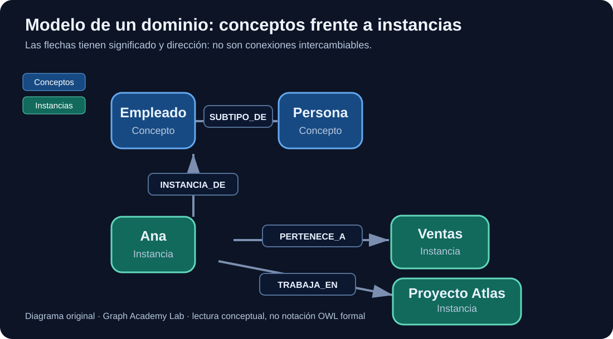

# Semana 01 — Entender y modelar grafos de verdad

> **Tiempo recomendado:** 8–10 horas · **Nivel:** Python básico · **Resultado:** un modelo de dominio ejecutable, con pruebas y decisiones justificadas.



## 1. Qué vas a saber hacer

Al terminar esta unidad podrás:

1. Explicar qué representa un nodo y qué representa una relación, sin confundir estructura con significado.
2. Distinguir un **concepto** (Empleado) de una **instancia** (Ana).
3. Modelar relaciones dirigidas y justificar su dirección.
4. Implementar un grafo con Python y consultar sus conexiones.
5. Detectar errores frecuentes de modelado antes de introducir una base de datos.

**Pregunta de partida:** si tenemos las tablas `empleados`, `departamentos` y `proyectos`, ¿qué aporta un grafo? La respuesta no es «ser más moderno»: aporta una forma explícita de representar y recorrer relaciones. SQL también puede expresar relaciones y recorridos, por ejemplo con consultas recursivas. Elegir grafo requiere valorar patrones de consulta, mantenimiento y complejidad.

## 2. De una tabla SQL a un grafo

Supón estos datos:

| empleado_id | empleado | departamento | proyecto |
|---|---|---|---|
| 1 | Ana | Ventas | Atlas |
| 2 | Luis | Datos | Atlas |
| 3 | Eva | Ventas | Boreal |

En SQL podrías normalizar las entidades y relacionarlas mediante claves foráneas. En un grafo de propiedades podrías modelar:

- `(:Persona {id: 1, nombre: "Ana"})`
- `(:Departamento {codigo: "VENTAS"})`
- `(:Proyecto {codigo: "ATLAS"})`
- `(Ana)-[:PERTENECE_A]->(Ventas)`
- `(Ana)-[:TRABAJA_EN]->(Atlas)`

El modelo permite formular preguntas como «¿qué empleados del departamento Ventas participan en proyectos donde también trabajan empleados de Datos?». **El grafo no garantiza por sí solo que esa consulta sea más rápida que SQL**; hay que medir con datos y consultas representativos.

### Concepto vs instancia: el error que debes evitar

En el dibujo, `Empleado` y `Persona` son **categorías**; `Ana` es un individuo. Estas relaciones tienen significados distintos:

- `Empleado SUBTIPO_DE Persona`: toda instancia de Empleado es también una instancia de Persona, si esa es la semántica adoptada.
- `Ana INSTANCIA_DE Empleado`: Ana es un individuo de la categoría Empleado.
- `Ana PERTENECE_A Ventas`: vínculo organizativo; no es una relación de subclase.

En una implementación Neo4j también podrías representar a Ana con la etiqueta `:Empleado`. El modelo del diagrama es **didáctico**, no una prescripción de almacenamiento.

## 3. Fundamento matemático

Un grafo dirigido es `G = (V, E)`, donde `V` es el conjunto de vértices y `E ⊆ V × V` el conjunto de aristas dirigidas. En un **multigrafo dirigido**, pueden existir varias aristas entre dos nodos.

Ejemplo: `(Ana, Atlas)` puede tener tanto `TRABAJA_EN` como `LIDERA`. Si el tipo de relación importa, no basta con almacenar «Ana está conectada con Atlas».

Un **camino** es una secuencia de aristas conectadas. Un camino estructural no implica causalidad, equivalencia semántica ni validez de negocio.

## 4. Laboratorio reproducible: Python y NetworkX

### Preparar el entorno

```bash
mkdir graph-academy-ejercicios
cd graph-academy-ejercicios
python -m venv .venv
# Linux/macOS:
source .venv/bin/activate
# Windows PowerShell:
# .venv\Scripts\Activate.ps1
python -m pip install "networkx>=3,<4" pytest
```

Crea `modelo.py`:

```python
import networkx as nx

def construir_grafo() -> nx.MultiDiGraph:
    g = nx.MultiDiGraph()

    g.add_node("concepto:persona", tipo="concepto", nombre="Persona")
    g.add_node("concepto:empleado", tipo="concepto", nombre="Empleado")
    g.add_node("persona:ana", tipo="instancia", nombre="Ana")
    g.add_node("departamento:ventas", tipo="instancia", nombre="Ventas")
    g.add_node("proyecto:atlas", tipo="instancia", nombre="Atlas")

    g.add_edge("concepto:empleado", "concepto:persona",
               key="subtipo", relacion="SUBTIPO_DE")
    g.add_edge("persona:ana", "concepto:empleado",
               key="instancia", relacion="INSTANCIA_DE")
    g.add_edge("persona:ana", "departamento:ventas",
               key="departamento", relacion="PERTENECE_A")
    g.add_edge("persona:ana", "proyecto:atlas",
               key="proyecto", relacion="TRABAJA_EN")
    return g

def relaciones_desde(g: nx.MultiDiGraph, origen: str) -> list[tuple[str, str]]:
    return [
        (destino, datos["relacion"])
        for _, destino, _, datos in g.out_edges(origen, keys=True, data=True)
    ]

if __name__ == "__main__":
    grafo = construir_grafo()
    for destino, relacion in relaciones_desde(grafo, "persona:ana"):
        print(f"Ana --{relacion}--> {destino}")
```

Ejecuta `python modelo.py`. Deberías ver las tres relaciones salientes de Ana.

### Pruebas automáticas

Crea `test_modelo.py`:

```python
from modelo import construir_grafo, relaciones_desde

def test_ana_es_instancia_de_empleado():
    g = construir_grafo()
    assert ("concepto:empleado", "INSTANCIA_DE") in relaciones_desde(g, "persona:ana")

def test_todas_las_relaciones_tienen_tipo():
    g = construir_grafo()
    assert all(
        datos.get("relacion")
        for _, _, _, datos in g.edges(keys=True, data=True)
    )

def test_direccion_importa():
    g = construir_grafo()
    assert g.has_edge("persona:ana", "departamento:ventas")
    assert not g.has_edge("departamento:ventas", "persona:ana")

def test_cinco_nodos_y_cuatro_aristas():
    g = construir_grafo()
    assert g.number_of_nodes() == 5
    assert g.number_of_edges() == 4
```

Ejecuta `pytest -q`. **Resultado esperado:** cuatro tests correctos.

### Experimento: cambia el modelo

Añade `LIDERA` entre Ana y Atlas además de `TRABAJA_EN`. El multigrafo permite ambas relaciones. ¿Qué cambia si usas `nx.DiGraph` y guardas un único atributo `relacion` en la arista?

**Explicación:** en un `DiGraph` solo hay una arista por par ordenado de nodos; una segunda llamada a `add_edge` actualiza atributos de la arista existente. En `MultiDiGraph` puedes distinguir aristas mediante claves.

## 5. Ejercicios graduados

### Nivel 1 — Comprensión

1. Explica por qué `Ana SUBTIPO_DE Persona` sería un error en este modelo.
2. Dibuja `Luis TRABAJA_EN Atlas` y `Luis PERTENECE_A Datos`.
3. ¿Cuál es la diferencia entre una relación dirigida y una relación simétrica?

### Nivel 2 — Código

4. Añade a Luis y al departamento Datos al script, con tests.
5. Escribe `personas_de_departamento(g, departamento_id)` para recuperar las personas conectadas por `PERTENECE_A`.
6. Implementa una comprobación de que todas las relaciones `INSTANCIA_DE` terminan en un nodo de tipo `concepto`.

### Nivel 3 — Diseño

7. Una persona puede trabajar en dos departamentos con porcentajes de dedicación distintos. Diseña dónde guardarías el porcentaje y cómo representarías su vigencia temporal.
8. El negocio afirma que «Libro» y «Comprador» son sinónimos. ¿Los fusionarías automáticamente? Describe qué evidencia necesitarías.

## 6. Soluciones razonadas y pistas

**Ejercicio 1.** `SUBTIPO_DE` conecta categorías; Ana es una instancia. Lo correcto en nuestro modelo es `Ana INSTANCIA_DE Empleado` y `Empleado SUBTIPO_DE Persona`.

**Ejercicio 5.** Una solución sencilla:

```python
def personas_de_departamento(g, departamento_id):
    resultado = []
    for origen, _, datos in g.in_edges(departamento_id, data=True):
        if datos.get("relacion") == "PERTENECE_A":
            resultado.append(origen)
    return resultado
```

**Ejercicio 7.** Si una relación tiene atributos propios (porcentaje, fecha de inicio y fin), puedes colocarlos en la arista del grafo de propiedades. Si necesitas múltiples periodos históricos, evalúa relaciones múltiples o una entidad intermedia `Asignacion`. La decisión depende de cómo consultes y audites los cambios.

**Ejercicio 8.** No: equivalencia textual no significa equivalencia conceptual. Hay que revisar definiciones, alcance, contexto, propietario y fuentes antes de aprobar una relación de sinonimia.

## 7. Aplicación a tu catálogo de biblioteca digital

Construye una ficha de concepto con estos campos:

| Campo | Ejemplo | ¿Por qué? |
|---|---|---|
| id | `concepto:libro` | Identidad estable |
| nombre | Libro | Presentación |
| definición | Persona u organización que... | Significado |
| fuente | Glosario comercial v2 | Trazabilidad |
| estado | Borrador | Gobernanza |
| responsable | Equipo de datos | Revisión |
| relaciones | relacionado con Cuenta | Navegación semántica |

**Entregable:** un archivo CSV o JSON con cinco conceptos, sus definiciones y sus relaciones, más una página explicando qué ambigüedades quedan por resolver.

## 8. Lista de verificación

- [ ] Puedo distinguir categoría e individuo.
- [ ] Sé justificar la dirección de cada relación.
- [ ] He ejecutado el script y los tests.
- [ ] Puedo explicar cuándo una arista necesita atributos.
- [ ] No confundo «estar conectado» con «ser equivalente».

## 9. Lecturas oficiales

- [NetworkX — guía de uso](https://networkx.org/documentation/stable/)
- [NetworkX MultiDiGraph](https://networkx.org/documentation/stable/reference/classes/multidigraph.html)
- [Neo4j — Graph Data Modeling Fundamentals](https://graphacademy.neo4j.com/courses/modeling-fundamentals/)
- [RDF 1.1 Primer — W3C](https://www.w3.org/TR/rdf11-primer/)

**Siguiente:** semana 2, recorridos, caminos, ciclos y algoritmos.
