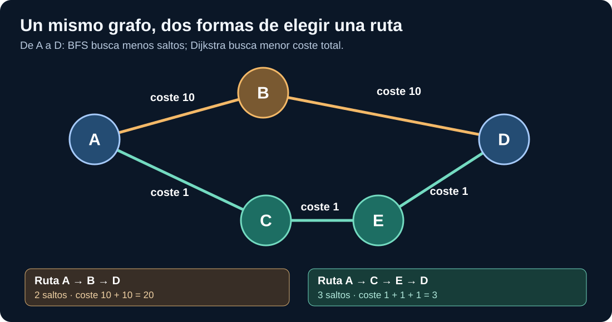

# Semana 02 — Aprender a recorrer un grafo sin saber algoritmos

**Curso para programadores que empiezan de cero.** Duración recomendada: dos sesiones de 90 minutos y tres de práctica. **Antes de empezar:** [semana 01, nodos y relaciones](semana-01.md). **Después:** [semana 03, grafos de propiedades y RDF](semana-03.md).

> **Objetivo:** al terminar podrás explicar con tus propias palabras qué es un camino, reconocer las siglas BFS y DFS, seguir sus pasos en un dibujo, entender la diferencia con Dijkstra y ejecutar tres ejemplos en Python. No tendrás que memorizar fórmulas antes de saber qué significan.

## 1. Nuestro problema: ¿cómo ir desde A hasta D?

Antes de escribir código, piensa en un mapa de calles. **A**, **B**, **C**, **D** y **E** son lugares; las líneas indican caminos que puedes recorrer.

En este dibujo existen dos rutas principales desde **A** hasta **D**:

- **Ruta 1: A → B → D.** Pasas por dos conexiones o *saltos*. Si solo te importa usar el menor número de conexiones, esta es mejor.
- **Ruta 2: A → C → E → D.** Pasas por tres conexiones. Si las líneas tienen costes, esta ruta puede ser mejor a pesar de tener más saltos.

**Un salto** significa atravesar una arista entre dos nodos. Recorrer A → B → D supone dos saltos, aunque aparezcan tres letras. Esta diferencia es importante.

**¿Qué estamos buscando?** Una secuencia de nodos que conecte el origen con el destino. A esa secuencia la llamamos **camino**.

### Vocabulario antes de seguir

| Palabra | Definición sin tecnicismos | Ejemplo |
|---|---|---|
| Nodo o vértice | Un elemento del grafo | A o B |
| Arista | Una conexión entre elementos | A → B |
| Vecino | Un nodo conectado directamente con otro | B y C son vecinos de A |
| Origen | Punto donde empieza la búsqueda | A |
| Destino | Punto al que quieres llegar | D |
| Camino | Secuencia de conexiones desde origen hasta destino | A → C → E → D |
| Salto | Una arista que recorres | A → C cuenta como uno |
| Grafo dirigido | Las conexiones tienen sentido de circulación | A → B no implica B → A |
| Coste o peso | Número asociado a una conexión | A → B cuesta 10 |
| Camino mínimo | El mejor camino según un criterio declarado | Menos saltos **o** menor coste |

**Compruébalo:** ¿A → C → E → D tiene tres o cuatro saltos? Tiene **tres**: A→C, C→E y E→D.

## 2. ¿Por qué necesitamos algoritmos?

Una persona puede ver cinco nodos y encontrar las dos rutas. ¿Qué pasaría con **cinco millones de nodos** y cientos de millones de conexiones? No podrías revisar todos los caminos a mano.

Un **algoritmo** es simplemente una lista de instrucciones precisas para resolver un problema. Igual que ordenar números o buscar una palabra en una lista, podemos definir una forma sistemática de recorrer un grafo.

Estudiaremos tres estrategias distintas:

1. **BFS**: recorrer por niveles, empezando por los vecinos cercanos.
2. **DFS**: explorar una rama hasta donde se pueda y después retroceder.
3. **Dijkstra**: buscar un camino con el menor **coste acumulado**, cuando los pesos son no negativos.

No son tecnologías exclusivas de Neo4j. Son **algoritmos generales** que se pueden implementar en Python y aparecen en muchas bibliotecas de grafos.

## 3. BFS explicado desde cero, sin fórmulas

**BFS** son las siglas inglesas de **Breadth-First Search**. En español: **búsqueda en anchura** o **búsqueda por niveles**.

Imagínate buscando a alguien en un edificio:

1. Primero preguntas en las habitaciones que están a una puerta de ti.
2. Si no lo encuentras, preguntas en las habitaciones que están a dos puertas.
3. Después en las que están a tres puertas.
4. Continúas hasta encontrarlo o terminar las opciones.

Esa es la idea de BFS: **explorar primero las distancias más cortas en número de conexiones**.

### Ejecutemos BFS sobre el dibujo

Suponemos que las conexiones van en el sentido indicado por las flechas y que miramos primero B y luego C:

| Paso | Nodo que atendemos | Nuevos vecinos encontrados | Pendientes de examinar |
|---|---|---|---|
| 0 | A | B y C | B, C |
| 1 | B | D | C, D |
| 2 | C | E | D, E |
| 3 | D | Objetivo encontrado | E |

Cuando llegamos a **D**, sabemos que la ruta encontrada por BFS en este grafo no ponderado es **A → B → D**, de **2 saltos**. Los pesos 10 y 10 no importan si la pregunta es únicamente «¿cuántas conexiones atravieso?».

### ¿Qué es una cola?

Una **cola** (*queue*, en inglés) es como la fila del supermercado:

- El primero que entra es el primero que sale.
- A esta regla se le llama **FIFO**, siglas de *First In, First Out*: «primero en entrar, primero en salir».
- BFS utiliza una cola para recordar qué nodos debe examinar después.

En Python, la clase \`deque\` de \`collections\` ofrece una cola eficiente.

### Primer código Python: BFS desde cero

Crea un archivo \`bfs.py\`:

~~~python
from collections import deque

# Cada clave representa un nodo y su lista son los vecinos
# que podemos visitar siguiendo las flechas.
grafo = {
    "A": ["B", "C"],
    "B": ["D"],
    "C": ["E"],
    "E": ["D"],
    "D": []
}

def bfs_camino(grafo, inicio, objetivo):
    pendientes = deque([(inicio, [inicio])])
    visitados = {inicio}

    while pendientes:
        nodo, camino = pendientes.popleft()

        if nodo == objetivo:
            return camino

        for vecino in grafo[nodo]:
            if vecino not in visitados:
                visitados.add(vecino)
                pendientes.append((vecino, camino + [vecino]))

    return None

print(bfs_camino(grafo, "A", "D"))
~~~

**Resultado esperado:**

~~~text
['A', 'B', 'D']
~~~

### Entiende el código línea por línea

- \`grafo\` es un diccionario. La clave A tiene como vecinos B y C.
- \`pendientes\` almacena pares: nodo y camino recorrido hasta él.
- \`visitados\` es un conjunto que evita procesar un mismo nodo repetidamente.
- \`while pendientes\` significa «mientras queden nodos por revisar».
- \`popleft()\` retira el primer elemento de la cola, por eso el recorrido avanza por niveles.
- Cuando el nodo coincide con \`objetivo\`, devolvemos el camino.
- Si no hay camino, devolvemos \`None\`.

**Prueba un cambio:** sustituye \`grafo["B"] = ["D"]\` por \`grafo["B"] = []\`. Ahora la ruta corta desaparece y BFS debe encontrar **A → C → E → D**.

### ¿Cuándo conviene BFS?

Cuando buscas el **menor número de relaciones** que conectan dos entidades, por ejemplo:

- ¿A cuántas conexiones de una persona está otra?
- ¿Cuál es el menor número de enlaces entre dos páginas?
- ¿Qué camino necesita menos saltos en una red donde todas las conexiones cuestan lo mismo?

**Límite:** BFS no garantiza el menor coste de un camino cuando las aristas tienen pesos diferentes.

## 4. DFS: la misma búsqueda, pero por profundidad

**DFS** son las siglas inglesas de **Depth-First Search**. En español: **búsqueda en profundidad**.

En lugar de revisar primero a todos los vecinos cercanos, DFS elige una rama y la sigue **hasta donde pueda**. Si llega a un callejón sin salida, **retrocede** y prueba otra.

Imagina un laberinto:

1. Llegas a una bifurcación.
2. Eliges un pasillo.
3. Sigues caminando hasta una salida o un callejón sin salida.
4. Si no encuentras la salida, vuelves a la última bifurcación.
5. Pruebas otra posibilidad.

Eso es la búsqueda en profundidad.

### Cómo se comporta sobre nuestro dibujo

Supongamos que DFS visita primero **C**, luego **E**, luego **D**:

| Paso | Nodo visitado | Siguiente decisión |
|---|---|---|
| 0 | A | Elegir la rama C |
| 1 | C | Continuar a E |
| 2 | E | Continuar a D |
| 3 | D | Objetivo encontrado |

Obtiene **A → C → E → D**, tres saltos. Pero conocemos otro camino de dos saltos: **A → B → D**.

**Conclusión:** DFS puede encontrar una ruta válida, pero **no garantiza la que tenga menos saltos**.

### ¿Qué es una pila?

Una **pila** (*stack*, en inglés) se parece a una pila de platos:

- Se coloca un plato encima de los demás.
- Al coger uno, normalmente se coge el último colocado.
- Esta regla se llama **LIFO**: *Last In, First Out*, «último en entrar, primero en salir».

DFS suele implementarse con una pila o mediante llamadas recursivas.

### Código Python de DFS

~~~python
def dfs_camino(grafo, inicio, objetivo):
    # Colocamos C para visitarlo antes que B.
    pendientes = [(inicio, [inicio])]
    visitados = set()

    while pendientes:
        nodo, camino = pendientes.pop()

        if nodo == objetivo:
            return camino

        if nodo in visitados:
            continue

        visitados.add(nodo)

        for vecino in grafo[nodo]:
            if vecino not in visitados:
                pendientes.append((vecino, camino + [vecino]))

    return None

print(dfs_camino(grafo, "A", "D"))
~~~

**Resultado esperado con el diccionario mostrado:** \`['A', 'C', 'E', 'D']\`. La lista de vecinos de A es \`['B','C']\`; al usar \`pop()\` (último elemento), DFS elige C antes que B.

**Qué debes entender:** cambiar el orden de vecinos puede cambiar **qué ruta** descubre primero DFS. La respuesta no es necesariamente única.

### ¿Cuándo conviene DFS?

Es una técnica fundamental para:

- Explorar todas las entidades alcanzables.
- Detectar estructuras y ciclos mediante variantes apropiadas.
- Resolver problemas de «¿existe algún camino?».
- Implementar otros algoritmos sobre grafos.

**Cuidado:** una DFS simple que devuelve el primer camino encontrado **no** sirve para afirmar «este es el camino más corto».

## 5. ¿Qué es un grafo ponderado?

Ahora olvidemos durante un momento el número de saltos.

Supón que cada conexión representa un trayecto y tiene un **coste**: minutos, kilómetros, euros o cualquier número que quieras minimizar.

Las aristas del dibujo tienen estos costes:

| Arista | Coste |
|---|---:|
| A → B | 10 |
| B → D | 10 |
| A → C | 1 |
| C → E | 1 |
| E → D | 1 |

**Ruta corta en saltos:** A → B → D: 2 saltos, coste **10 + 10 = 20**.

**Ruta barata en coste:** A → C → E → D: 3 saltos, coste **1 + 1 + 1 = 3**.

¿Ves la diferencia? «Camino más corto» es ambiguo si no dices **qué estás minimizando**.

- **Menos saltos:** 2, por B.
- **Menor coste total:** 3, por C y E.

Llamamos **grafo ponderado** a un grafo cuyas aristas tienen un valor numérico asociado (un *peso*). No todo peso representa distancia: puede significar duración, riesgo o penalización. Debes documentar su significado antes de ejecutar un algoritmo.

## 6. Dijkstra: encontrar la ruta de menor coste

**Dijkstra** es el apellido del informático Edsger W. Dijkstra; **no es una sigla**.

El **algoritmo de Dijkstra** busca caminos de coste mínimo desde un origen cuando los pesos que utiliza son **no negativos**.

Su intuición es:

1. Empieza en A con coste acumulado 0.
2. Calcula cuánto costaría llegar a sus vecinos: B cuesta 10, C cuesta 1.
3. Atiende primero la opción cuyo **coste acumulado es menor**: C.
4. Desde C llega a E con coste 2.
5. Desde E llega a D con coste 3.
6. Como las alternativas no mejoran ese valor, obtiene la ruta A → C → E → D.

### Paso a paso con cantidades

| Paso | Nodo atendido | Coste mínimo conocido al llegar |
|---|---|---:|
| Inicio | A | 0 |
| 1 | C | 1 |
| 2 | E | 2 |
| 3 | D | 3 |

El camino que pasa por B costaría 20, por lo que no es el de menor coste.

**No uses Dijkstra con pesos negativos sin estudiar las condiciones del algoritmo.** Puede producir resultados incorrectos para ese escenario. Hay otros algoritmos, como Bellman–Ford, con condiciones y costes diferentes.

### Ejecución con NetworkX

NetworkX es una biblioteca de Python para representar grafos y ejecutar algoritmos. No es una base de datos persistente; la usamos para aprender antes de introducir sistemas como Neo4j.

Instala la dependencia desde la raíz de tu copia del repositorio:

~~~bash
python -m pip install -r laboratorios/requirements.txt
~~~

Ejecuta este código **independiente de la biblioteca anterior**:

~~~python
import networkx as nx

rutas = nx.DiGraph()

rutas.add_edge("A", "B", coste=10)
rutas.add_edge("B", "D", coste=10)
rutas.add_edge("A", "C", coste=1)
rutas.add_edge("C", "E", coste=1)
rutas.add_edge("E", "D", coste=1)

# 1. Menor número de conexiones:
print(nx.shortest_path(rutas, "A", "D"))

# 2. Menor coste acumulado:
print(nx.shortest_path(rutas, "A", "D", weight="coste"))

# 3. Valor del coste de la ruta de menor coste:
print(nx.shortest_path_length(rutas, "A", "D", weight="coste"))
~~~

**Resultado esperado:**

~~~text
['A', 'B', 'D']
['A', 'C', 'E', 'D']
3
~~~

**¿Por qué se pasa \`weight="coste"\`?** Porque hemos llamado \`coste\` a la propiedad numérica de cada arista. NetworkX necesita saber qué atributo debe sumar para comparar alternativas.

**¿Y si no lo pasas?** La función considera todas las conexiones con el mismo coste de un salto y recupera la ruta de menos aristas.

## 7. O(V + E): qué significa esa expresión

En muchos materiales técnicos aparece:

> «BFS tiene coste O(V + E)».

Para entender esa frase **no hace falta conocer matemáticas avanzadas**, pero sí las piezas:

- **V** viene de *vertices* (vértices): cantidad de nodos.
- **E** viene de *edges* (aristas): cantidad de conexiones.
- **O(...)** se lee «orden de» y expresa una forma de describir cómo crece el trabajo necesario cuando el problema se hace grande.

Si tienes 5 nodos y 5 aristas, hay una cantidad pequeña de elementos por visitar. Si tienes un millón de nodos y diez millones de aristas, habrá muchísimo más trabajo.

Para una representación mediante **listas de adyacencia**, BFS y DFS pueden recorrer cada vértice y cada arista un número limitado de veces; por eso su complejidad temporal usual es **O(V + E)**.

### Qué NO significa

- No significa que una operación siempre tarde exactamente V + E milisegundos.
- No significa que BFS sea más rápido que cualquier otra implementación en todas las situaciones.
- No dice nada por sí sola sobre latencia de red, índice de una base de datos, memoria o tamaño de cada resultado.

**Por ahora quédate con la idea:** a mayor número de elementos y relaciones, más trabajo. En unidades de algoritmos avanzados profundizaremos en estructuras de datos y complejidad.

## 8. Volvemos a nuestro proyecto: la biblioteca ficticia

Hasta ahora hemos usado letras A, B, C, D y E para estudiar **cómo funciona una búsqueda** sin distraernos con términos de negocio.

En la biblioteca, las letras se sustituyen por entidades reales del modelo:

~~~text
Marina Soler (Autor)
       |
       | ESCRIBIO
       v
El mapa de los grafos (Libro)
       |
       | TRATA_SOBRE
       v
Grafos (Tema)
~~~

Aquí el camino \`Autor → Libro → Tema\` tiene **dos saltos**. Es útil para contestar: «¿de qué temas escribe Marina?».

**Pero hay una diferencia crucial:** cuando utilizas un algoritmo general de camino más corto, ese algoritmo **no sabe** qué significan las etiquetas \`ESCRIBIO\` o \`TRATA_SOBRE\`. Solo recorre conexiones.

Para contestar preguntas fiables del catálogo debes seleccionar **tipos de relación apropiados**. Más adelante lo expresarás con Cypher:

~~~cypher
MATCH (a:Autor)-[:ESCRIBIO]->(l:Libro)-[:TRATA_SOBRE]->(t:Tema)
RETURN a.nombre AS autora, t.nombre AS tema;
~~~

No necesitas memorizar todavía Cypher. Por ahora observa cómo el patrón refleja la pregunta y exige relaciones con nombre y dirección.

## 9. Practica por niveles (sin mirar las soluciones)

**Nivel 1 — Comprender**

1. En el dibujo, ¿cuántos saltos tiene A → C → E → D? ¿Cuánto cuesta?
2. ¿Qué significan las siglas BFS y DFS en inglés y en español?
3. Explica con tus palabras «cola FIFO» y «pila LIFO» usando un ejemplo cotidiano.

**Nivel 2 — Modificar código**

4. En el diccionario Python, elimina \`B → D\`. ¿Qué ruta devuelve BFS?
5. Cambia el coste A → B de 10 a 1 y el de B → D de 10 a 1. ¿Qué ruta de coste mínimo esperas ahora?
6. Cambia el orden de los vecinos de A. ¿Por qué puede cambiar la primera ruta de DFS sin alterar la existencia de caminos?

**Nivel 3 — Aplicar al modelo**

7. Construye un grafo simple con Autor → Libro → Tema. Escribe una función Python que recupere solo las relaciones \`TRATA_SOBRE\`.
8. Dibuja una biblioteca donde un libro tenga dos temas. ¿Aumenta el número de nodos y el número de saltos de Autor a cada Tema?
9. ¿Sería correcto usar «camino más corto» para concluir que un autor tiene experiencia profesional en un tema? Razona qué datos faltan.

## 10. Soluciones razonadas

**1.** Tres saltos: A→C, C→E y E→D. El coste es 1+1+1=3. **No confundas el número de nodos del camino (cuatro) con las aristas recorridas (tres).**

**2.** BFS = *Breadth-First Search*, búsqueda en anchura. DFS = *Depth-First Search*, búsqueda en profundidad. Ambos recorren grafos, pero **el orden de exploración es diferente**.

**3.** En una cola FIFO atiendes al primero que esperaba; en una pila LIFO atiendes al último que colocaste. Esta decisión explica la diferencia de orden entre BFS y DFS.

**4.** Si B ya no conecta con D, BFS encontrará A→C→E→D. El algoritmo no está «roto»: el grafo tiene otras conexiones disponibles.

**5.** Con A→B=1 y B→D=1, A→B→D cuesta 2, menor que la ruta inferior de coste 3. Dijkstra debe escoger ahora la ruta superior.

**6.** DFS sigue prioritariamente una rama. Cambiar el orden en el que introduces vecinos cambia la rama que visita primero. Eso no hace que una ruta deje de existir.

**9.** No. Una conexión entre autor, libro y tema puede mostrar que existe una obra relacionada con el tema. No prueba nivel de experiencia, actualidad del conocimiento, autoridad ni calidad. **Un grafo contiene afirmaciones, no garantías de verdad.**

## 11. Comprobación antes de avanzar

Puedes continuar cuando seas capaz de hacer estas cinco cosas **sin copiar**:

- Dibujar un grafo pequeño y contar los saltos de un camino.
- Explicar BFS, DFS, FIFO y LIFO sin acrónimos sin definir.
- Mostrar un ejemplo donde DFS encuentre una ruta más larga que BFS.
- Mostrar un ejemplo donde una ruta con más saltos cueste menos.
- Ejecutar NetworkX y explicar por qué el argumento \`weight\` cambia el resultado.

Si una explicación sigue sin encajarte, repite el ejemplo de cinco nodos y cambia **una sola conexión**. Predecir el resultado antes de ejecutar es una forma muy útil de aprender a programar algoritmos.

**Siguiente:** [Semana 03 — grafo de propiedades y RDF](semana-03.md). **Fuente ejecutable:** [laboratorio 01 con NetworkX](../laboratorios/01-modelado.md).

## Fuentes primarias para ampliar

- [NetworkX — Shortest Paths](https://networkx.org/documentation/stable/reference/algorithms/shortest_paths.html)
- [NetworkX — BFS traversal](https://networkx.org/documentation/stable/reference/algorithms/traversal.html)
- [NetworkX — DFS traversal](https://networkx.org/documentation/stable/reference/algorithms/traversal.html)
- [Neo4j GraphAcademy — Fundamentals](https://graphacademy.neo4j.com/courses/neo4j-fundamentals/)

**Nota pedagógica:** estas fuentes sirven como respaldo y ampliación; no necesitas ir a ellas para comprender el ejemplo explicado aquí. Los datos, figuras y ejercicios son originales y completamente ficticios.
