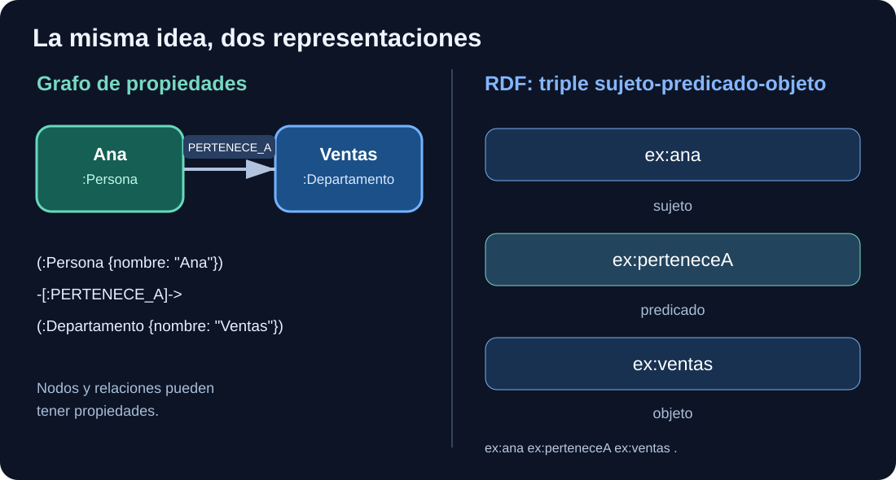

# Semana 03 — Dos maneras de representar conocimiento: grafo de propiedades y RDF

**Unidad 3 de 42 · Fundamentos.** Antes: [Semana 02 — recorridos](semana-02.md). Después: [Semana 04 — Neo4j AuraDB](semana-04.md). Tiempo: 8–12 horas.

## Antes de empezar: una advertencia sobre el orden

Has trabajado con **nodos, relaciones e identificadores** en la semana 01, y con **caminos y recorridos** en la semana 02. Esos conceptos son el fundamento. Esta unidad introduce una segunda manera de **representar** conocimiento, pero **todavía no te pide diseñar ontologías OWL**.

Para evitar confusión, tienes dos niveles:

- **Objetivo obligatorio ahora:** distinguir un grafo de propiedades de un conjunto de triples RDF, entender sujeto/predicado/objeto y reconocer una IRI.
- **Adelanto, no materia que debas dominar aún:** RDFS, SKOS, OWL, SHACL, GraphDB y razonadores. Los aprenderás paso a paso en las semanas 11–14 y los talleres posteriores.

### ¿Por qué aprender esto antes de Neo4j?

Porque el mismo ejemplo aparecerá en dos entornos. Primero lo representaremos con **nodos conectados** y después como **afirmaciones triples**. Necesitas reconocer que son formas distintas de expresar información relacionada, no aprender todos los estándares en una sola sesión.

### Una misma frase: dos representaciones

**Frase:** «Marina escribió El mapa de los grafos».

En el grafo de propiedades:

~~~text
(:Autor {id:"A-001"}) ──ESCRIBIO──▶ (:Libro {isbn:"ISBN-001"})
~~~

En RDF se podría expresar así, eligiendo la dirección del predicado:

~~~text
Sujeto:   libro001
Predicado: dcterms:creator
Objeto:   autor001
~~~

**¿Por qué la flecha parece invertida?** Porque el predicado **«creador de este recurso»** apunta del libro a la autora, mientras que la relación **«escribió»** va de la autora al libro. No es un error: cada relación debe leerse como una oración. **RDF no impone que uses el mismo sentido que Cypher.**

**Control de comprensión:** identifica qué entidad se describe en el triple, qué relación se afirma y hacia qué otra entidad apunta. Si puedes hacerlo, estás preparado para estudiar las primeras líneas Turtle.

---

## 1. ¿Por qué existen varios modelos de grafo?

En las primeras dos semanas has construido un grafo de biblioteca con Python. Ahora distinguimos dos modelos que pueden representar conexiones, pero tienen **mecanismos y semánticas distintos**:

- **Grafo de propiedades:** nodos y aristas tipadas con propiedades. Neo4j utiliza este enfoque; Cypher expresa patrones sobre él.
- **RDF:** afirmaciones expresadas como triples sujeto–predicado–objeto. W3C define la semántica básica y formatos interoperables; SPARQL consulta estos datos.

RDF no es una base de datos concreta. Puedes guardar RDF en un archivo Turtle, en GraphDB u otro triple store, o manejarlo en memoria con RDFLib.

**Idea crucial:** almacenar entidades relacionadas no convierte automáticamente un grafo en una ontología. La ontología formal introduce clases, propiedades y axiomas —por ejemplo, OWL— cuya interpretación es distinta de una etiqueta de base de datos.

## 2. Representemos exactamente la misma afirmación

Queremos almacenar:

> «Marina Soler escribió El mapa de los grafos».

### En un grafo de propiedades

~~~cypher
MERGE (a:Autor {id: "A-001"})
SET a.nombre = "Marina Soler"
MERGE (l:Libro {isbn: "ISBN-001"})
SET l.titulo = "El mapa de los grafos"
MERGE (a)-[:ESCRIBIO]->(l);
~~~

Identificamos dos nodos con etiquetas `Autor` y `Libro`, y creamos una relación dirigida de tipo `ESCRIBIO`. Las propiedades `id`, `isbn` y `titulo` acompañan a las entidades.

### En RDF (Turtle)

~~~turtle
@prefix ex: <https://example.org/biblioteca/> .
@prefix dcterms: <http://purl.org/dc/terms/> .

ex:libro001 dcterms:title "El mapa de los grafos"@es .
ex:libro001 dcterms:creator ex:autor001 .
ex:autor001 <https://example.org/biblioteca/nombre> "Marina Soler"@es .
~~~

Observa la **dirección** del triple: aquí `libro001 dcterms:creator autor001` afirma que el creador del recurso libro es el autor. No hemos usado `ESCRIBIO` directamente, sino una propiedad estándar reutilizable.

¿Qué ganas? Un vocabulario ampliamente documentado y un modelo RDF interoperable. ¿Qué no ganas automáticamente? Que el dato sea verdadero o que un razonador sepa quién es Marina sin declaraciones adicionales.

**Importante:** `example.org` es un espacio de ejemplo; un proyecto de producción debe diseñar IRIs estables y bajo control del propietario del vocabulario.

## 2.1. En RDF también aparecen dos puntos, pero no significan una etiqueta

En la primera clase viste `:Libro` en **Cypher**, que significa una **etiqueta de nodo**. Ahora vamos a leer `ex:libro001` en **Turtle**, un formato para escribir datos RDF.

**No son el mismo lenguaje.**

Mira estas dos líneas:

~~~turtle
@prefix ex: <https://example.org/biblioteca/> .
ex:libro001 ex:titulo "El mapa de los grafos" .
~~~

### Traduce cada carácter importante

- `@prefix` es una declaración de abreviatura.
- `ex:` es el **nombre corto** de un espacio de identificadores.
- `<https://example.org/biblioteca/>` es la parte larga que reemplaza ese prefijo. Los signos `<` y `>` delimitan una IRI completa en Turtle.
- `ex:libro001` significa la IRI completa `https://example.org/biblioteca/libro001`; **no es un nodo con etiqueta libro001**.
- `ex:titulo` significa la IRI `https://example.org/biblioteca/titulo`, utilizada aquí como predicado.
- `"El mapa de los grafos"` es un **literal de texto**.
- El punto final `.` termina la afirmación RDF.

Lee la segunda línea como una frase: **«el recurso identificado como libro001 tiene como título El mapa de los grafos»**.

### Compara los tres usos sin mezclarlos

| Expresión | Lenguaje | Significado |
|---|---|---|
| `(:Libro)` | Cypher | Nodo que tiene la **etiqueta** Libro |
| `"libro:ISBN-001"` | Python | **Cadena de texto** que elegimos como ID de laboratorio |
| `ex:libro001` | Turtle | **IRI abreviada** mediante un prefijo RDF |

Que los tres contengan el carácter `:` **no** significa que estén hablando de la misma operación. Aprenderlos como si fueran idénticos te generaría confusión al cambiar de herramienta.

**Pregunta:** ¿si reemplazas `ex:` por `biblioteca:` en todas las líneas y actualizas su declaración con la **misma IRI base**, cambia el significado del RDF? **No**: cambia la abreviatura textual, pero sigue identificando los mismos recursos.

**Otra pregunta:** ¿qué pasa si cambias únicamente el texto `"El mapa de los grafos"` por `"Un libro diferente"`? Cambia el **objeto literal** de esa afirmación; estás declarando otro título.

En esta etapa es suficiente que puedas leer estos triples. No necesitas conocer todavía SPARQL, OWL ni razonadores.

---

## 3. Qué es un triple RDF

En `sujeto predicado objeto`:

- El **sujeto** identifica el recurso que se describe, normalmente con una IRI o un nodo anónimo.
- El **predicado** es una IRI que expresa una propiedad.
- El **objeto** puede ser otra IRI, un nodo anónimo o un literal como `"El mapa..."@es`.

En Turtle el punto cierra la afirmación. El prefijo `ex:` permite abreviar una IRI completa. No se guarda el prefijo como parte del significado: es una abreviatura sintáctica.

Un literal `"Grafo"@es` lleva un idioma, mientras que `"2025"^^xsd:gYear` tiene tipo de dato. No son simplemente cadenas sin semántica de tipo.

## 4. RDF no equivale a RDFS, SKOS ni OWL

Estos términos tienen responsabilidades distintas:

| Tecnología | Para qué se utiliza |
|---|---|
| RDF | Modelo de afirmaciones en triples |
| RDFS | Vocabulario básico de clases, subclases, dominios y rangos |
| SKOS | Conceptos, etiquetas preferidas y jerarquías de tesauros |
| OWL 2 | Axiomas y razonamiento ontológico formal |
| SHACL | Comprobar condiciones de calidad de grafos RDF |
| SPARQL | Consultar y, con las operaciones adecuadas, actualizar RDF |

Por ejemplo, «Grafo» como **tema de biblioteca** puede representarse como `skos:Concept`. No es necesariamente una clase OWL. Y `skos:broader` no significa automáticamente `rdfs:subClassOf`.

## 5. Laboratorio Python con RDFLib

Desde la raíz del proyecto:

~~~bash
python -m pip install -r laboratorios/requirements.txt
python laboratorios/metadatos_rdf.py
python -m pytest laboratorios/tests/test_metadatos_rdf.py -q
~~~

El ejemplo crea un libro ficticio con identificador, título, creador y fecha mediante términos Dublin Core. Después lo exporta a tres formatos:

- Turtle (`.ttl`)
- N-Triples (`.nt`)
- JSON-LD (`.jsonld`)

**¿Por qué tantos formatos?** Porque la *representación textual* no equivale al *modelo abstracto RDF*. Lo importante es que se conserven las afirmaciones; el orden de las líneas puede cambiar.

La prueba vuelve a importar cada serialización y compara los triples. Al no usar nodos anónimos, el ejercicio permite comparar conjuntos directamente. En proyectos con blank nodes o grafos nombrados hay que emplear comprobaciones adecuadas.

## 6. Primeras consultas SPARQL

Con el vocabulario de temas del repositorio:

~~~sparql
PREFIX skos: <http://www.w3.org/2004/02/skos/core#>
SELECT ?concepto ?nombre
WHERE {
  ?concepto a skos:Concept ;
            skos:prefLabel ?nombre .
  FILTER(LANG(?nombre) = "es")
}
ORDER BY ?nombre
~~~

**Lectura paso a paso:** seleccionamos conceptos SKOS, buscamos su etiqueta preferida, filtramos por idioma español y ordenamos alfabéticamente.

Esto se parece a filtrar una tabla, pero el patrón trabaja sobre afirmaciones RDF; no depende de que cada recurso tenga exactamente las mismas columnas.

Para practicar consultas de forma reproducible, continúa con [el laboratorio de metadatos y exportación RDF](../laboratorios/07-metadatos-y-exportacion-rdf.md), ya publicado, y más adelante ampliarás las consultas SPARQL.

## 7. Cuándo elegir qué modelo

**Neo4j/grafo de propiedades:** cuando las consultas operativas se expresan naturalmente con patrones de entidades y relaciones, y el ecosistema Cypher/driver responde a los requisitos.

**RDF/triple store (p. ej., GraphDB):** cuando la interoperabilidad con estándares, las ontologías, las IRIs persistentes o los grafos RDF son centrales.

**SQL:** cuando el modelo relacional, las transacciones y las consultas tabulares cubren mejor los requisitos con menor coste operativo.

También existen soluciones híbridas, pero **cada motor adicional obliga a decidir la fuente de verdad, la sincronización y el comportamiento ante fallos**. Esa arquitectura se estudia más adelante; de momento no la necesitamos para aprender a consultar.

## 8. Ejercicios guiados

**A.** Representa el tema «Grafos» en el modelo de propiedades y como recurso RDF. Distingue entre `Tema` y `skos:Concept`.

**B.** Cambia el título del libro. ¿Deberías cambiar también su IRI? Justifica la necesidad de identidad estable.

**C.** Crea dos títulos, uno `@es` y otro `@en`, para el mismo libro. Comprueba cómo se guardan.

**D.** Explica por qué `owl:sameAs` es una afirmación excesiva para dos libros que simplemente tienen títulos parecidos.

**E.** ¿Puedes comprobar automáticamente que cada libro tenga título solo utilizando la sintaxis RDF? ¿Qué añade SHACL?

## 9. Soluciones razonadas

**B.** No necesariamente: identificadores e IRIs deben distinguir identidad de etiqueta. El título puede cambiar o traducirse sin cambiar la entidad representada.

**D.** `owl:sameAs` afirma identidad entre recursos, no similitud textual. Los libros con títulos iguales pueden ser entidades distintas.

**E.** RDF permite la ausencia de afirmaciones; para requisitos de completitud usamos SHACL (con `sh:minCount`) en un grafo de validación.

## 10. Puente hacia Neo4j

Ya tienes tres herramientas intelectuales: modelo, recorrido y diferencia entre grafo de propiedades y RDF. En la **semana 04** implementarás el catálogo ficticio en Neo4j Aura; en las semanas 11–14 volverás al mismo dominio como vocabulario, ontología y validación RDF.

**Siguiente:** [Semana 04 — Neo4j AuraDB](semana-04.md).

## Documentación primaria

- [RDF 1.1 Primer — W3C](https://www.w3.org/TR/rdf11-primer/)
- [RDF 1.1 Concepts — W3C](https://www.w3.org/TR/rdf11-concepts/)
- [SKOS Reference — W3C](https://www.w3.org/TR/skos-reference/)
- [DCMI Metadata Terms](https://www.dublincore.org/specifications/dublin-core/dcmi-terms/)
- [Neo4j Cypher Manual](https://neo4j.com/docs/cypher-manual/current/)
