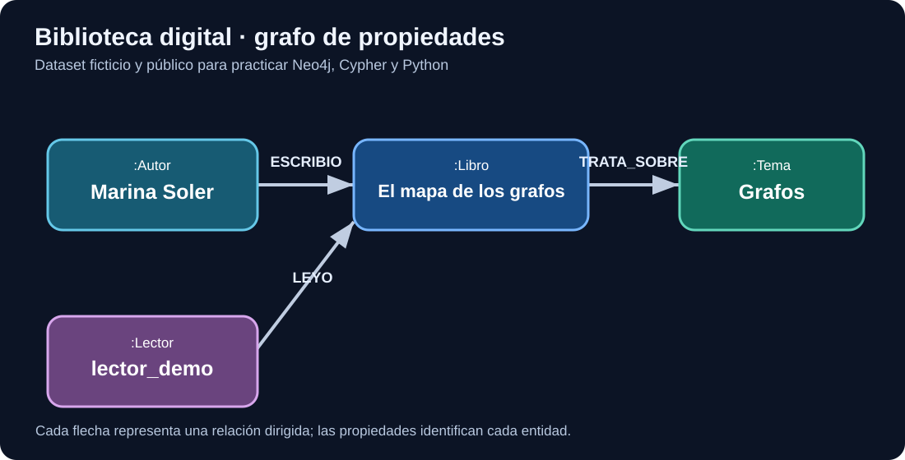

# Semana 04 — Neo4j AuraDB y modelado de un grafo

**Caso público ficticio:** una biblioteca digital que relaciona libros, autores, temas y lectores. No se usan datos empresariales ni información privada.



## Antes de empezar: qué estamos cambiando respecto a Python

En las [semanas 1–3](semana-01.md) construimos el modelo, aprendimos a recorrerlo en NetworkX y distinguimos el grafo de propiedades de RDF. **Ahora no vamos a volver a diseñar todo desde cero:** implementaremos la misma biblioteca ficticia en una base de datos persistente.

NetworkX es una librería para trabajar con grafos en memoria dentro de Python. Neo4j es un **sistema de gestión de bases de datos** que almacena nodos y relaciones, ejecuta Cypher y puede atender consultas de una aplicación a través de un protocolo de red.

**Neo4j AuraDB** es una oferta gestionada. *Instancia* no equivale a *base de datos*: una instancia representa recursos y configuración de servicio. Los planes tienen características y límites distintos; no presupongas multi-base de datos en cualquier plan.

### Objetivo mínimo de la primera sesión

1. Abrir el entorno y ejecutar \`RETURN 1 AS prueba\`.
2. Crear **un autor y un libro** con \`MERGE\`.
3. Unirlos con una relación \`ESCRIBIO\`.
4. Consultar el patrón con \`MATCH\`.
5. Comprobar que ejecutar el mismo \`MERGE\` de nuevo no crea otro autor con la misma clave.

Este ejercicio pequeño se hace **antes** de cargar todo el CSV; si no sabes recuperar estos dos nodos, el problema no se resuelve añadiendo más datos.

### Cypher explicado paso a paso

~~~cypher
MERGE (a:Autor {id:'A-DEMO'})
SET a.nombre = 'Autora de ejemplo'
MERGE (l:Libro {isbn:'ISBN-DEMO'})
SET l.titulo = 'Libro de ejemplo'
MERGE (a)-[:ESCRIBIO]->(l);
~~~

- \`MERGE (a:Autor {id:'A-DEMO'})\` busca o crea un nodo con etiqueta \`Autor\` e \`id\` indicado.
- \`SET a.nombre\` establece o actualiza una propiedad.
- \`MERGE (l:Libro ...)\` identifica el libro con una clave estable.
- \`MERGE (a)-[:ESCRIBIO]->(l)\` expresa una relación dirigida entre los dos nodos ya vinculados por las variables \`a\` y \`l\`.

Consultamos:

~~~cypher
MATCH (a:Autor {id:'A-DEMO'})-[:ESCRIBIO]->(l:Libro)
RETURN a.nombre AS autor, l.titulo AS titulo;
~~~

**Resultado esperado:** una fila: «Autora de ejemplo» y «Libro de ejemplo». \`MATCH\` busca; no crea. \`RETURN\` selecciona los datos mostrados.

**Error deliberado:** sustituye \`->\` por \`<-\` en el patrón y observa si devuelve filas. Eso enseña que la dirección forma parte de la consulta.

Para evitar mezclar ejemplos temporales con el dataset principal usa un entorno de laboratorio limpio o identificadores separados. No ejecutes eliminaciones indiscriminadas en una instancia compartida.

### ¿En qué se diferencia de SQL?

En SQL, una relación de autoría entre libros y autores podría representarse mediante una tabla \`autoria(autor_id, isbn)\`, con claves foráneas. En el modelo de propiedades, la autoría es una **arista dirigida de tipo ESCRIBIO**. En ambos casos hay reglas de identidad y consistencia que debes diseñar.

**Próxima lección:** [Semana 05 — consultas Cypher](semana-05.md), donde iremos de un patrón fijo a filtros, agrupaciones y consultas multi-salto.

## Objetivos

1. Crear una instancia de prueba AuraDB y acceder a la interfaz de consultas.
2. Diferenciar nodos, etiquetas, propiedades y relaciones en Cypher.
3. Definir identificadores estables y restricciones de unicidad.
4. Justificar cuándo conviene una relación y cuándo una propiedad.

## 1. Del modelo conceptual a los datos

La biblioteca contiene libros (identificados por ISBN ficticio), autores (ID), temas (código) y lectores (ID). Las relaciones `ESCRIBIO`, `TRATA_SOBRE` y `LEYO` conectan entidades. El grafo es una **representación de un catálogo de biblioteca**, no una ontología formal.

### Decisiones de modelado

- `Libro` tiene `isbn`, `titulo`, `anio`.
- `Autor` tiene `id`, `nombre`.
- `Tema` tiene `codigo`, `nombre`.
- `Lector` tiene `id`, `alias`.
- `LEYO` puede tener `fecha`; si se necesita historial de múltiples lecturas, se puede modelar una entidad `Lectura` o relaciones con identificador propio.

**Antipatrón:** almacenar todos los autores en una cadena separada por comas en `Libro.autores` cuando necesitas navegar entre autores y obras.

## 2. Preparar AuraDB

1. Entra en [Neo4j Aura](https://console.neo4j.io/) y crea una instancia de pruebas según las opciones disponibles en tu cuenta.
2. Guarda la contraseña **fuera de GitHub**. La consola muestra el URI de conexión.
3. Abre el explorador de consultas de Neo4j y ejecuta `RETURN 1 AS prueba;`.
4. Comprueba que devuelve una fila con `prueba = 1`.

**Seguridad:** no publiques URI privados, usuarios, contraseñas ni capturas con credenciales. Usa exclusivamente datos ficticios de este curso.

## 3. Crear restricciones

Ejecuta estas consultas una a una. Una restricción de unicidad impide que dos nodos con la misma etiqueta compartan el mismo valor de la propiedad indicada; no exige que todos los nodos tengan esa propiedad.

```cypher
CREATE CONSTRAINT libro_isbn IF NOT EXISTS
FOR (l:Libro) REQUIRE l.isbn IS UNIQUE;

CREATE CONSTRAINT autor_id IF NOT EXISTS
FOR (a:Autor) REQUIRE a.id IS UNIQUE;

CREATE CONSTRAINT tema_codigo IF NOT EXISTS
FOR (t:Tema) REQUIRE t.codigo IS UNIQUE;

CREATE CONSTRAINT lector_id IF NOT EXISTS
FOR (l:Lector) REQUIRE l.id IS UNIQUE;
```

## 4. Cargar un conjunto de datos reproducible

Ejecuta el fichero [`ejemplos/neo4j/01_biblioteca.cypher`](../ejemplos/neo4j/01_biblioteca.cypher) en el editor de consultas. Los identificadores son ficticios.

Observa `MERGE`: localiza o crea un patrón. Para evitar duplicados, usa claves de negocio estables y restricciones. En la importación de relaciones, primero hacemos `MERGE` de los nodos por clave y después de la relación; no fusionamos un patrón complejo sin cuidado.

## 5. Comprobar el grafo

```cypher
MATCH (l:Libro) RETURN l.titulo, l.anio ORDER BY l.anio;
```

```cypher
MATCH (a:Autor)-[:ESCRIBIO]->(l:Libro)
RETURN a.nombre AS autor, collect(l.titulo) AS libros
ORDER BY autor;
```

```cypher
MATCH (l:Libro)-[:TRATA_SOBRE]->(t:Tema)
RETURN t.nombre AS tema, count(l) AS libros
ORDER BY libros DESC;
```

## 6. Ejercicios

1. Añade un libro y un autor; ejecuta dos veces la carga y explica por qué el número de nodos no debería crecer.
2. Añade `idioma` a `Libro`. ¿Por qué es una propiedad y no necesariamente un nodo?
3. Modela un premio literario. ¿Conviene nodo, propiedad o relación? Razona según las consultas que quieras responder.
4. Intenta crear dos libros con el mismo `isbn` y observa el error de unicidad.

### Soluciones y criterios

- Ejercicio 1: `MERGE (l:Libro {isbn: 'ISBN-004'}) SET l.titulo = '...' ` y la misma técnica para `Autor`; verifica con `MATCH (l:Libro) RETURN count(l)`.
- Ejercicio 2: un idioma como atributo simple suele bastar; si necesitas metadatos propios del idioma o relaciones entre idiomas, considera un nodo.
- Ejercicio 3: un nodo `Premio` permite fecha, categoría, jurado y múltiples premiados; un booleano `premiado` perdería información.

## 7. Entregable

Captura **sin credenciales** del grafo, fichero Cypher reproducible, descripción de etiquetas y relaciones, y un párrafo sobre decisiones de modelado.

## Referencias oficiales

- [Aura: conectar aplicaciones](https://neo4j.com/docs/aura/connecting-applications/overview/)
- [Cypher: restricciones](https://neo4j.com/docs/cypher-manual/current/schema/constraints/create-constraints/)
- [GraphAcademy: modelado](https://graphacademy.neo4j.com/courses/modeling-fundamentals/)
