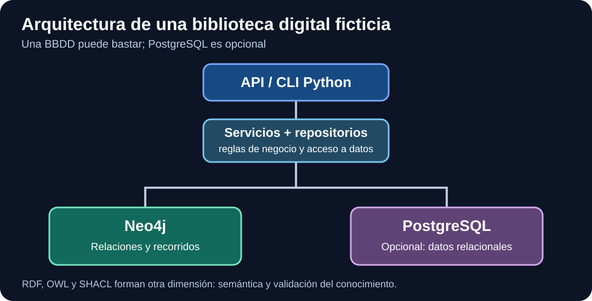

# Semana 07 — Aplicaciones Python profesionales con Neo4j



**Bloque Neo4j · Clase 4/4 · 8–12 horas.** Primero estudia [semana 06](semana-06.md). Después podrás pasar a [semana 08](semana-08.md) y al bloque RDF/OWL. **Objetivo:** conectar Python a AuraDB, ejecutar Cypher con parámetros, utilizar transacciones, separar la lógica de negocio y probar resultados sin publicar secretos.

## 1. De una consulta manual a una aplicación

En la consola Neo4j escribías `MATCH` y recibías una tabla. Una aplicación Python necesita hacer eso sin intervención humana y controlar problemas: datos ausentes, fallo de conexión, credenciales incorrectas y operaciones parcialmente completadas.

Imagina la solicitud: «Muéstrame los libros clasificados como GRAFOS». El flujo recomendado es:

1. El usuario solicita un tema.
2. Un **servicio** comprueba que la entrada sea válida.
3. Un **repositorio** ejecuta una consulta parametrizada.
4. El driver devuelve filas.
5. La aplicación presenta resultados o informa de que no hay datos.

La regla «el código de tema no puede estar vacío» pertenece al servicio. La sentencia Cypher pertenece al repositorio. Las credenciales pertenecen a configuración segura, **nunca al código publicado**.

## 2. Instalar dependencias y configurar secretos

Desde la raíz de una copia de este repositorio:

```bash
python -m venv .venv
# Linux / macOS:
source .venv/bin/activate
# Windows PowerShell:
# .venv\Scripts\Activate.ps1
python -m pip install -r ejemplos/neo4j/requirements.txt
```

Copia `ejemplos/neo4j/.env.example` a `ejemplos/neo4j/.env`. Edita el archivo **solo localmente**:

```dotenv
NEO4J_URI=neo4j+s://TU_INSTANCIA.databases.neo4j.io
NEO4J_USERNAME=neo4j
NEO4J_PASSWORD=TU_CONTRASENA_PRIVADA
NEO4J_DATABASE=neo4j
```

El URI y nombre de base deben corresponder a tu instancia; no supongas que todos los planes permiten crear varias bases. `.env` se excluye mediante `.gitignore`. En un sistema real puede ser mejor utilizar un gestor de secretos.

## 3. Driver, conexión y ciclo de vida

El driver oficial administra conexiones y ofrece sesiones y transacciones. El siguiente programa carga un archivo de configuración junto al script:

```python
import os
from pathlib import Path

from dotenv import load_dotenv
from neo4j import GraphDatabase

load_dotenv(Path(__file__).with_name(".env"))

uri = os.environ["NEO4J_URI"]
auth = (os.environ["NEO4J_USERNAME"], os.environ["NEO4J_PASSWORD"])

with GraphDatabase.driver(uri, auth=auth) as driver:
    driver.verify_connectivity()
    print("Conexión Neo4j verificada")
```

**Explicación:**

- `GraphDatabase.driver` crea un objeto reutilizable; no debes abrir uno por cada libro.
- `verify_connectivity` comprueba si el servicio responde y las credenciales permiten conectar.
- `with` asegura el cierre del driver.
- Una **sesión** es más ligera que un driver y no debe compartirse entre hilos.
- Un error de autenticación o red **no debe convertirse falsamente** en una lista de libros vacía.

Si `verify_connectivity` falla, confirma URI, cuenta, estado de Aura y acceso de red antes de investigar la consulta.

## 4. Consultas parametrizadas: aprender a hacerlas seguras

Queremos listar libros asociados al tema `GRAFOS`. La consulta es:

```cypher
MATCH (l:Libro)-[:TRATA_SOBRE]->(t:Tema {codigo:$codigo})
RETURN l.isbn AS isbn, l.titulo AS titulo
ORDER BY titulo;
```

El símbolo `$codigo` es un **parámetro**. No lo reemplaces concatenando texto de entrada no confiable dentro de Cypher.

```python
def buscar_libros_por_tema(driver, codigo: str, database: str) -> list[dict]:
    records, _, _ = driver.execute_query(
        """
        MATCH (l:Libro)-[:TRATA_SOBRE]->(t:Tema {codigo:$codigo})
        RETURN l.isbn AS isbn, l.titulo AS titulo
        ORDER BY titulo
        """,
        codigo=codigo,
        database_=database,
    )
    return [record.data() for record in records]
```

**Resultado esperado** con el dataset principal: dos elementos, `ISBN-001` y `ISBN-002`. Si consultas un tema inexistente, la respuesta es `[]`.

El argumento `database_` es una opción de configuración del driver, **no** una variable Cypher. La documentación oficial recomienda seleccionar la base explícitamente para evitar una resolución adicional de la base predeterminada.

## 5. Transacciones gestionadas: varias operaciones atómicas

Una transacción en Neo4j garantiza que sus cambios se confirmen juntos o se reviertan ante un fallo. Usa una función de transacción para operaciones de negocio que deben mantener integridad.

```python
def registrar_lectura_tx(tx, lector_id: str, isbn: str) -> bool:
    registro = tx.run(
        """
        MATCH (p:Lector {id:$lector})
        MATCH (l:Libro {isbn:$isbn})
        MERGE (p)-[:LEYO]->(l)
        RETURN p.id AS lector
        """,
        lector=lector_id,
        isbn=isbn,
    ).single()
    return registro is not None

with driver.session(database="neo4j") as session:
    registrada = session.execute_write(
        registrar_lectura_tx, "L-001", "ISBN-001"
    )
```

**Qué pasa exactamente:**

1. `driver.session` abre una sesión y `with` la cierra al terminar.
2. `execute_write` ejecuta la función de transacción gestionada.
3. `tx.run` ejecuta una consulta dentro de esa transacción.
4. Los dos `MATCH` comprueban que existen lector y libro.
5. `MERGE` crea la relación si no existe entre esos nodos ya vinculados.
6. Si faltan los extremos, no se crea nada y devolvemos `False`.

**Aviso de experto:** las transacciones gestionadas pueden reintentar la función después de errores temporales. Por tanto, dentro de ella evita envíos de correo, cobros o cambios externos no idempotentes. Una operación sobre otra BBDD, por ejemplo PostgreSQL, no forma parte de la misma transacción ACID automáticamente.

## 6. Distinguir respuestas vacías de errores

| Caso | Resultado o reacción |
|---|---|
| No hay libros para un tema | Lista vacía `[]` |
| Código de tema vacío | Error de validación del servicio |
| Contraseña incorrecta | Error de autenticación, nunca imprimir secretos |
| No existe lector o libro | No crear relación; devolver estado de ausencia |
| Consulta Cypher inválida | Corregir código, no reintentar para siempre |
| Error transitorio | Considerar el mecanismo de reintentos del driver y su seguridad |

**Antipatrón:** `except Exception: return []`. Oculta incidentes de infraestructura aparentando que la consulta tuvo éxito sin resultados.

## 7. Un proyecto Python bien organizado

```text
biblioteca-app/
├── src/biblioteca/
│   ├── domain.py
│   ├── services.py
│   ├── repositories.py
│   └── neo4j_repository.py
├── tests/
│   ├── test_services.py
│   └── test_neo4j_integration.py
├── .env.example
└── pyproject.toml
```

- **Dominio:** tipos y reglas.
- **Servicio:** valida, coordina y responde.
- **Repositorio:** contrato de acceso a los datos.
- **Adaptador Neo4j:** ejecución concreta de Cypher.
- **Prueba unitaria:** utiliza un repositorio de memoria para comprobar reglas sin red.
- **Prueba de integración:** usa la instancia real de pruebas y confirma que la consulta se ejecuta correctamente.

Prueba la separación sin AuraDB con el [laboratorio 04](../laboratorios/04-arquitectura.md).

```bash
python -m pip install -r laboratorios/requirements.txt
python -m pytest laboratorios/tests/test_servicios.py -q
```

**Resultado esperado:** se superan los tests unitarios del caso de uso. Pero eso **no certifica** que el motor remoto y el driver funcionen en toda configuración: para ello se necesitan tests de integración.

## 8. ORM, OGM o driver: una decisión consciente

- **SQLAlchemy ORM:** mapeo de objetos Python a bases relacionales; útil con PostgreSQL, no es un ORM nativo de Neo4j.
- **neomodel:** OGM para Neo4j, ofrece una abstracción de objetos y relaciones sobre el grafo.
- **Driver Neo4j oficial:** permite controlar Cypher, parámetros, sesiones y transacciones.
- **RDFLib:** gestiona RDF; no debe confundirse con un OGM de Neo4j ni con razonamiento OWL completo.

Para aprender, empieza con Cypher y el driver oficial. Evalúa neomodel cuando conozcas el modelo, las consultas y sus restricciones. No uses OGM para evitar aprender Cypher.

## 9. Ejercicios graduados

**Inicial**

1. Conecta a AuraDB usando un archivo local de configuración y comprueba conectividad.
2. Busca libros con el código `GRAFOS`; comprueba que aparecen dos ISBN.
3. Busca un tema inexistente; comprueba que obtienes `[]`.

**Intermedio**

4. Implementa `buscar_libro_por_isbn(driver, isbn, database)` y devuelve `dict | None`.
5. Escribe una consulta parametrizada para autores por tema.
6. Utiliza una transacción gestionada para registrar una lectura, incluyendo el caso de un ISBN inexistente.

**Avanzado**

7. Implementa un contrato `LibroRepository` y dos adaptadores: uno en memoria y otro en Neo4j.
8. Diseña manejo de errores que distinga validación, datos ausentes, red y fallo de sintaxis.
9. Propón una estrategia de consistencia si PostgreSQL almacena préstamos y Neo4j almacena una proyección de relaciones.

## 10. Soluciones orientativas

**Ejercicio 4:**

```python
def buscar_libro_por_isbn(driver, isbn: str, database: str) -> dict | None:
    records, _, _ = driver.execute_query(
        """
        MATCH (l:Libro {isbn:$isbn})
        RETURN l.isbn AS isbn, l.titulo AS titulo
        """,
        isbn=isbn,
        database_=database,
    )
    return records[0].data() if records else None
```

La consulta recibe el valor por parámetro y distingue de manera explícita `None` de un libro encontrado.

**Ejercicio 7:** el [laboratorio de arquitectura](../laboratorios/04-arquitectura.md) permite comprobar reglas con un repositorio en memoria; el adaptador de Neo4j debe respetar el mismo contrato. Una prueba unitaria aislada no sustituye a la prueba de integración con Neo4j real.

**Examen aplicado:** [Evaluación práctica de Neo4j (100 puntos)](../laboratorios/08-evaluacion-neo4j.md). Termina esta evaluación antes de pasar al bloque siguiente.

## 11. Evaluación de salida del bloque de Neo4j

Sin mirar soluciones deberías poder:

1. Diseñar un modelo Autor–Libro–Tema–Lector.
2. Crear constraints e importar datos idempotentemente.
3. Responder diez preguntas Cypher con patrones, agregación y filtros.
4. Ejecutar consultas parametrizadas desde Python.
5. Agrupar una escritura relacionada en una transacción gestionada.
6. Explicar los distintos tipos de error y el peligro de ocultarlos.
7. Defender cuándo añadir SQL u otro motor y cuándo no.

**Entrega:** código, consultas, resultados, tests y explicación escrita; nunca credenciales.

**Siguiente tema:** [Semana 08 — ArcadeDB](semana-08.md). Para la ruta completa, consulta [el mapa ordenado](../ruta.html).

## Documentación oficial

- [Neo4j Python Driver](https://neo4j.com/docs/python-manual/current/)
- [Conexión al servidor](https://neo4j.com/docs/python-manual/current/connect/)
- [Consultas simples](https://neo4j.com/docs/python-manual/current/query-simple/)
- [Transacciones](https://neo4j.com/docs/python-manual/current/transactions/)
- [SQLAlchemy ORM](https://docs.sqlalchemy.org/en/20/orm/)
- [neomodel](https://neomodel.readthedocs.io/)

**Estado:** unidad explicada en detalle a partir de fuentes oficiales; ejecución integral contra AuraDB pendiente de verificar.
